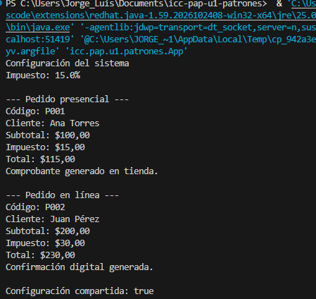

# Sistema de gestión de pedidos (Trabajo)

Una aplicación en Java que registra y procesa pedidos presenciales y en línea, aplicando el impuesto configurado.

# Patrones seleccionados

1. **Singleton** |Configuracion|
2. **Factory Method** |FabricaPedido, FabricaTienda, FabricaDigital|

## Por qué Singleton
El sistema dice que necesita una configuración de impuesto compartida por todos los componentes y una única instancia que la administre, para evitar inconsistencias. El Singleton garantiza que solo exista un objeto Configuracion accesible desde todo el programa.

## Por qué Factory Method
Los pedidos presenciales y en línea comparten datos, pero cada uno genera un comprobante distinto, y la empresa quiere agregar nuevas modalidades sin modificar el código principal. Con Factory Method, cada fábrica decide qué pedido crear y el resto del programa solo usa Pedido.

## Se ejecuta y compila asi:

