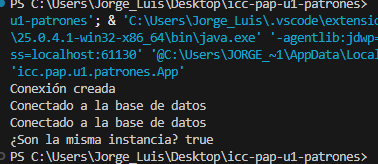

## Jorge Luis Padilla

## Explicacion:

El patron Singleton hace que de una clase solo se pueda crear un unico objeto, sin importar cuantas veces lo pidas.

En el ejemplo, la clase representa una conexion a la base de datos. La primera vez que se pide la conexion, se crea. Las siguientes veces, en vez de crear otra, se devuelve la misma que ya existe.

Es como tener una sola llave de la casa: todos usan esa misma y no se hacen copias nuevas cada vez.

Se nota en la salida porque el mensaje "Conexion creada" aparece una sola vez, y al comparar c1 con c2 da true, o sea que son el mismo objeto.

## Imagen de evidencia:
